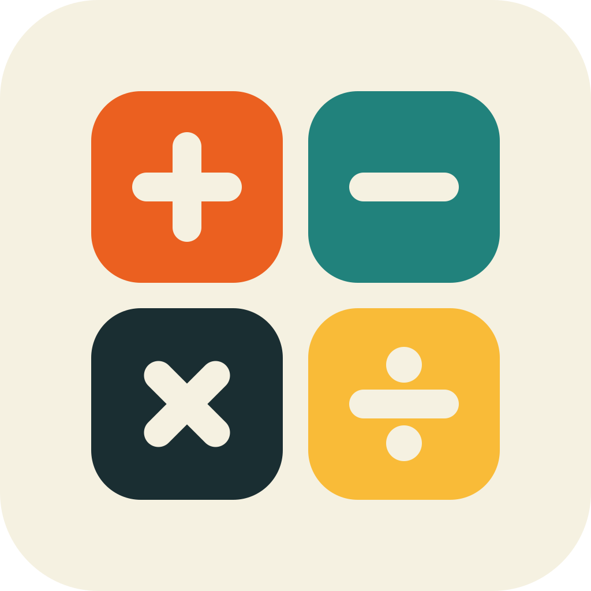

<!-- last_updated: 2026-11-13 -->

<!-- Authoring guidance: dev-docs/specs/README_SPEC.instructions.md -->
<!-- rumdl-disable MD033 MD041 -->

  

<h1 align="center">Text Math</h1>

  An app for anyone who wants to build mental arithmetic
  fluency and number sense by solving problems in their head and comparing
  more than one way to reach the answer.

  
  

  <a href="docs/USER_MANUAL.md">User manual</a>

<!-- rumdl-enable MD033 MD041 -->

---

## About

Text Math is designed for becoming comfortable working with numbers mentally. A
problem such as `19 + 28 + 13` should not need to be written out and carried
column by column; you might notice that `19 + 13` makes 32, or keep a running
total instead. Text Math generates problems that reward this kind of reasoning,
and after each one it shows two valid methods so you can compare approaches. It
values understanding, accuracy, and flexibility over speed or memorized
shortcuts. The goal is to truly do mental arithmetic in your head for skill
acquisition and for cognitive improvements.

## Features

- Work through a mixed set of 3, 5, or 10 generated problems covering
  addition, subtraction, multiplication, division, and fractions.
- Practice problems built around useful strategies: regrouping to round numbers,
  rounding and compensating, splitting by place value, connecting multiplication
  and division, fractions as equal parts, and halving to reach a unit fraction.
- Get a short, problem-specific hint whenever you want one, and automatically
  after a wrong answer.
- Have three tries at each problem before the answer is revealed.
- Review two solution methods for every problem, step by step.
- Division remainder problems.
- Turn on a solve timer, or hide your digits as you type with blind entry.
- Rate each problem Good or Bad, then copy or share all your ratings as plain
  text to look for patterns in any tool you choose.

## User Manual

See the [User Manual](docs/USER_MANUAL.md) for installation, setup, usage, and
troubleshooting.

## License

Text Math is proprietary software owned by Plain Text Office LLC. See
[LICENSE](LICENSE) for the terms; all rights reserved.
